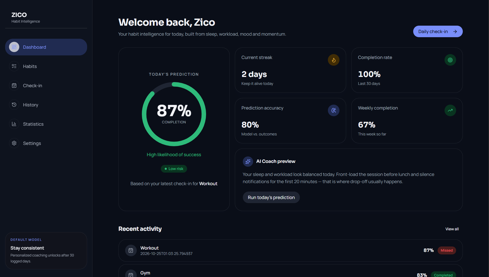

# Habit Coach

Habit Coach is a project I started as a way to practise machine learning after learning its basics. I also wanted to explore a problem I find interesting: knowing what to adjust in your routine to improve your chances of completing a habit or task.

The idea is to use information about a user's daily routine and previous records to predict the likelihood of completing a habit.


## What it does

- Predicts the likelihood of completing a habit using a trained machine learning model.
- Takes daily context and previous habit records into account to make predictions.
- Stores habit information and prediction records in a database.
- Uses an AI coaching component to provide guidance based on prediction results and habit context.

The project is still being developed. The current model is a default model trained on synthetic data, so its predictions are not yet as accurate as I want them to be. One of my next goals is to collect real-world data, evaluate the model properly, and improve it, then configure it for auto retraining itself with polished/filtered data about the user.

## Tech Stack

- **Frontend:** Tanstack Router, React
- **Backend:** Python, FastAPI
- **Machine Learning:** scikit-learn, Logistic Regression
- **Data Processing:** NumPy, pandas
- **Database:** PostgreSQL, Supabase
- **Database ORM:** SQLAlchemy
- **Migrations:** Alembic
- **Authentication:** Custom authentication with JWT
- **Model Storage:** Supabase Storage
- **AI Coaching:** Gemini API
- **Deployment:** Vercel and Render

## How it works

1. A user logs in and selects a habit.
2. The user provides information about their daily routine through the preconfigured features.
3. The backend retrieves relevant historical information, including the habit's current streak and previous-day completion.
4. The prediction engine prepares the features and passes them to the trained model.
5. The model returns a completion probability, which is used to produce a binary prediction.
6. The prediction and associated habit information are saved in the database.
7. The coaching component generates guidance using the prediction and relevant habit context.

## Project Structure

The repository is divided into two main directories:

```text
Habit-Coach/
├── frontend/
└── backend/
```

The frontend contains the React application, while the backend contains the FastAPI application, prediction logic, database models, API routes, and related services.

## Getting Started

### Prerequisites

- Python
- Node.js and npm
- A PostgreSQL database
- A Supabase project with the required database and model-storage configuration
- A Gemini API key

### 1. Clone this repo

```text
git clone https://github.com/young1dev/habit-coach.git
cd habit-coach
```

### 2. Set up the backend

```bash
cd backend
python -m venv .venv
```

Activate the virtual environment.

On Windows PowerShell/terminal (CTRL + J in vscode):

```powershell
.\.venv\Scripts\Activate.ps1
```

Install the dependencies:

```bash
pip install -r requirements.txt
```

Create a `.env` file in the root backend configuration location and supply the required values:

```env
DATABASE_URL=your-postgresql-connection-string
SECRET_KEY=your-secret-key

SUPABASE_URL=https://your-project.supabase.co
SUPABASE_SERVICE_ROLE_KEY=your-service-role-key

MODEL_SOURCE=supabase
MODEL_BUCKET=your-model-bucket-name
MODEL_OBJECT=your-model-object-path

GEMINI_API_KEY=your-gemini-api-key
```

Replace the placeholders with your own configuration. The model bucket and object path must match the location of the trained model in Supabase Storage.

### Upload the Default Model

The default trained model is located at:

`backend/app/models/default-model.pkl`

Upload `default-model.pkl` to your Supabase Storage bucket. Make sure the bucket name and object path match your `.env` configuration.

For example, if your bucket is named `ml-models`, set:

```
MODEL_SOURCE=supabase
MODEL_BUCKET=ml-models
MODEL_OBJECT=default-model.pkl
```

The backend downloads this model from Supabase Storage when it needs to make a prediction. Without a correctly uploaded model and matching configuration, the prediction endpoint will not work.

Run the database migrations:

```bash
alembic upgrade head
```

Start the backend:

```bash
uvicorn app.main:app --reload
```

The local API documentation should be available at:

[http://127.0.0.1:8000/docs](http://127.0.0.1:8000/docs)

### 3. Set up the frontend

Open another terminal and navigate to the frontend directory:

```bash
cd frontend
npm install
```

Create the frontend environment file and configure the backend API URL using the variable name expected by the application.

```env
VITE_API_URL=http://127.0.0.1:8000
```

Start the development server:

```bash
npm run dev
```

Open the local URL printed in the terminal.

## Database and Model Management

Habit Coach uses PostgreSQL to store users, habits, habit logs, and prediction logs. SQLAlchemy handles database access, while Alembic manages schema changes through migrations.

The trained model is stored in Supabase Storage and loaded by the backend. The application also caches the loaded model to avoid repeatedly downloading it during normal operation.

## Current Limitations and Future Work

The current model is a mini version of the big idea rather than a fully validated predictor of real-world behavior.

Planned improvements include:

- Collecting real-world habit data from beta users.
- Analyzing the data with pandas and other data-analysis tools.
- Evaluating model performance
- Using evaluation results to identify weaknesses in the model and guide future improvements.
- Exploring additional features that could help improve habit completion predictions.
- Adding more useful habit statistics and visualizations.
- Improving the coaching experience.
